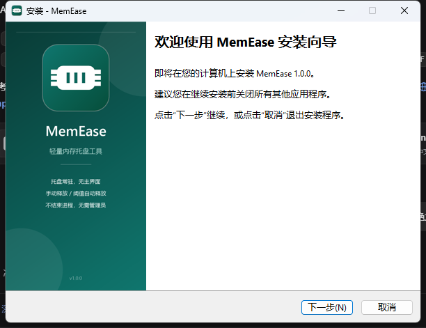

# MemEase


一个面向 Windows 10/11 的轻量内存释放工具：没有主界面，启动后只驻留在系统托盘。

- 左键或右键单击托盘图标打开菜单
- 手动“立即释放内存”
- 内存持续达到设定阈值时自动释放（可关闭，默认 80%）
- 开机自动启动、释放通知开关
- 标准安装向导或单文件便携版，不联网、无服务、无驱动

## 两种分发方式

| 文件 | 说明 |
| --- | --- |
| [`MemEase-Setup-1.0.exe`](dist/MemEase-Setup-1.0.exe) | **推荐**。标准安装向导，当前用户安装，创建开始菜单快捷方式、可选桌面快捷方式和卸载程序，无需管理员权限 |
| [`MemEase.exe`](dist/MemEase.exe) | 便携版，解压即用，不写入安装信息 |
| [`MemEase-1.0-win.zip`](dist/MemEase-1.0-win.zip) | 便携版压缩包，含说明、图标和许可证 |




## 使用

1. **安装版**：双击 `MemEase-Setup-1.0.exe`，按向导完成安装；安装完成后可勾选启动 MemEase。
   **便携版**：直接双击 `MemEase.exe`。
2. 托盘出现内存图标。Windows 11 默认会把新图标收进 `^` 溢出区，第一次运行会弹出提示。
3. 左键或右键单击托盘图标：

   - **立即释放内存**：马上执行一次回收
   - **自动释放**：关闭，或选择 65% / 70% / 75% / 80% / 85% / 90%
   - **开机自启**
   - **释放后显示通知**
   - **退出**

图标颜色随内存占用变化：低于 70% 为绿色，70%–84% 为琥珀色，85% 及以上为红色。悬停可看到精确占用率和已用/总内存。

鼠标左键单击托盘图标会弹出菜单；双击不会额外触发释放。

## 安装版说明

- 安装位置：`%LOCALAPPDATA%\Programs\MemEase`（当前用户目录，不触发 UAC）。
- 开始菜单：`MemEase → MemEase` / `MemEase → 卸载 MemEase`。
- 可选创建桌面快捷方式；安装向导默认勾选“登录 Windows 时自动启动 MemEase”，可取消。
- 安装程序会先关闭正在运行的 MemEase（包括便携版），再写入新文件；升级会保留原有设置。
- 卸载入口：Windows 设置 → 应用 → 已安装的应用 → MemEase → 卸载，或开始菜单中的卸载快捷方式。
- 卸载会关闭托盘程序，删除程序文件、快捷方式、开机启动项和 `HKCU\Software\MemEase` 设置。
- 安装包和主程序均未数字签名，首次运行可能触发 SmartScreen。

## 自动释放逻辑

- 每 2 秒采样一次系统物理内存占用。
- 连续 3 次（约 6 秒）达到或超过阈值才触发，避免瞬时尖峰误判。
- 触发后进入 3 分钟冷却，避免反复整理。
- 默认阈值 80%，自动释放默认开启。
- 手动释放不受冷却限制。

## 释放原理

MemEase 遍历当前登录会话中的进程，对工作集大于 24 MB 的闲置进程调用 Windows 的
[`EmptyWorkingSet`](https://learn.microsoft.com/en-us/windows/win32/api/psapi/nf-psapi-emptyworkingset)，
把这些进程里暂时不活跃的物理页移到 standby 列表或页面文件，从而降低“正在使用”的物理内存。

为了不干扰正常使用，会跳过：

- 最近一次前台应用（避免正在看的视频/正在玩的游戏被换出）
- 系统关键进程（System、csrss、wininit、lsass、dwm 等）
- 桌面和开始菜单相关进程（explorer、StartMenuExperienceHost 等）
- 安全软件（Windows Defender、火绒等）
- 桌面美化、壁纸类进程
- 其他登录会话中的进程

每次最多整理工作集最大的 64 个进程；不会结束任何进程，也不会修改页面文件或系统设置。

### 为什么不清空 standby 缓存？

很多“内存清理”工具会调用未公开的 `NtSetSystemInformation(SystemMemoryListInformation, ...)`
清空 standby 列表。但按 Windows 的定义，standby 本来就是可立即回收的“可用内存”，清空它通常只会让
后续启动应用变慢。MemEase 选择只回收闲置进程的工作集，把缓存管理交给 Windows 自己。

因此：

- 不需要管理员权限。
- 不调用未公开内核接口。
- 不使用驱动或服务。
- 释放后应用可能从磁盘重新加载页面，首次切换时略慢，这是正常现象。

内存不是越空越好。请按实际需要调整阈值，或在不需要时关闭自动释放。

## 轻量实测

在 Windows 11 x64、16 GB 内存环境实测：

| 项目 | 数值 |
| --- | --- |
| 单文件体积 | 59,904 字节（约 58.5 KB） |
| 安装包体积 | 约 2.1 MB |
| 便携版压缩包 | 约 51 KB |
| 常驻工作集 | 约 33 MB |
| 空闲 CPU | 30 秒约 0.09 秒 CPU 时间 |
| 线程 | 8 |
| 依赖 | Windows 自带的 .NET Framework 4.8 |

实际释放量取决于当前打开了哪些程序，常见为几百 MB 到数 GB；已经刚释放过时也可能只有几十 MB。

## 兼容性

- Windows 10 1903 及以上 / Windows 11
- x64、x86
- 需要 .NET Framework 4.8（Windows 10 1903+ 和 Windows 11 默认自带）
- 无需管理员权限

## 设置与卸载

设置保存在注册表：

```text
HKCU\Software\MemEase
```

开机启动使用：

```text
HKCU\Software\Microsoft\Windows\CurrentVersion\Run
```

**安装版卸载**：使用 Windows“已安装的应用”或开始菜单中的卸载程序。卸载程序会关闭托盘程序，
删除程序文件、开始菜单/桌面快捷方式、开机启动项和 `HKCU\Software\MemEase` 设置。

**便携版卸载**：从托盘菜单退出，删除 `MemEase.exe`；如需彻底清理，再删除上述两个注册表项。
程序不会写入其他位置，错误日志只会按需写入 `%LOCALAPPDATA%\MemEase\error.log`。

## 从源码构建

需要 Windows 自带的 .NET Framework 4.x 编译器 `csc.exe`，无需 Visual Studio 或 .NET SDK。

### 便携版

```powershell
powershell.exe -NoProfile -ExecutionPolicy Bypass -File .\build.ps1
```

如果使用 PowerShell 7：

```powershell
pwsh -File .\build.ps1
```

构建脚本会：

1. 编译 `tools/IconGen.cs`，生成多尺寸 `assets/MemEase.ico`
2. 编译 `src/*.cs` 为 `dist/MemEase.exe`
3. 打包 `dist/MemEase-1.0-win.zip`

### 安装包

安装包使用 [Inno Setup 6.7+](https://jrsoftware.org/isinfo.php) 构建：

```powershell
winget install -e --id JRSoftware.InnoSetup
powershell.exe -NoProfile -ExecutionPolicy Bypass -File .\build-installer.ps1
```

`build-installer.ps1` 会自动构建便携版、生成安装向导图片，并调用 Inno Setup 输出：

```text
dist\MemEase-Setup-1.0.exe
```

安装脚本位于 `installer/MemEase.iss`，中文语言包位于 `installer/ChineseSimplified.isl`。

源码文件为 UTF-8，编译器使用 `/codepage:65001`，确保中文界面正常。

## 注意事项

- 安装包和主程序均未数字签名，首次运行可能触发 SmartScreen；选择“更多信息 → 仍要运行”。
- 某些安全软件可能对“枚举进程 + OpenProcess”的行为敏感。程序只申请
  `PROCESS_QUERY_LIMITED_INFORMATION | PROCESS_SET_QUOTA` 权限，不会读取进程内存，也不会结束进程。
- 释放内存会改变进程的工作集，对性能敏感的场景请谨慎使用自动释放。
- 本项目在 Windows 11 上完成开发和测试，未在每一版 Windows 10 上逐一验证。

## 参考

- [WinMemoryCleaner](https://github.com/IgorMundstein/WinMemoryCleaner)：同类工具的功能与交互参考
- [ram-purge](https://github.com/hiyfoeorihly/ram-purge)：托盘/阈值自动清理思路参考
- [WinMemoryOpt](https://github.com/chienhaoc/WinMemoryOpt)：轻量内存优化工具的取舍参考
- [GlobalMemoryStatusEx / MEMORYSTATUSEX](https://learn.microsoft.com/en-us/windows/win32/api/sysinfoapi/ns-sysinfoapi-memorystatusex)
- [EmptyWorkingSet](https://learn.microsoft.com/en-us/windows/win32/api/psapi/nf-psapi-emptyworkingset)

代码为独立实现，未复制上述项目的源代码。

## 问题反馈

项目地址：[https://github.com/CFShark/MemEase](https://github.com/CFShark/MemEase)

发现 bug 或有改进建议，欢迎提交 [Issue](https://github.com/CFShark/MemEase/issues)。

## 许可证

[MIT](LICENSE.txt)
